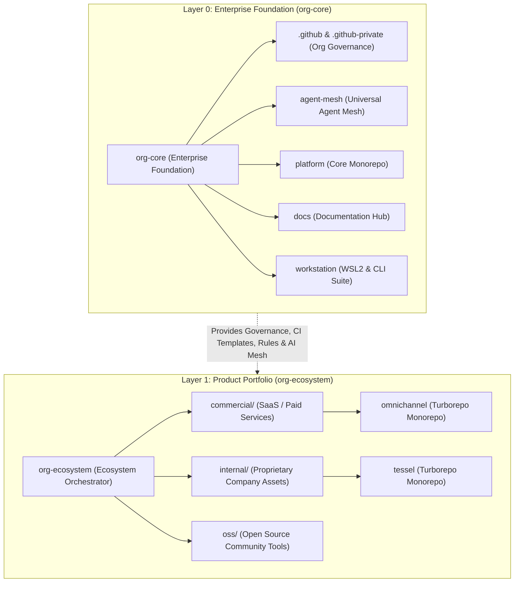

# Product Portfolio & Ecosystem Meta-Repository (`tupynambalucas-dev/org-ecosystem`)

Central orchestrator and unified multi-repository workspace for customer-facing SaaS products, proprietary internal assets, and open-source community solutions across the `tupynambalucas-dev` organization. This umbrella meta-repository coordinates autonomous product monorepos via [Mani](https://manicli.com) and multi-root IDE workspaces while preserving independent Git histories, branches, release lifecycles, and CI/CD pipelines.

---

## 1. Architecture Overview

The organization operates under a two-tier meta-repository topology separating foundational enterprise governance (`org-core`) from the commercial and proprietary product portfolio (`org-ecosystem`):



---

## 2. Managed Repositories & Navigation

| Repository | Path / Namespace | Branch | Documentation | Agent Context | Purpose |
| :--- | :--- | :--- | :--- | :--- | :--- |
| [`omnichannel`](./commercial/omnichannel/README.md) | `commercial/omnichannel` | `main` | [`README.md`](./commercial/omnichannel/README.md) | [`AGENTS.md`](./commercial/omnichannel/AGENTS.md) | Commercial multi-tenant omnichannel messaging gateway and FSM workflow engine for WhatsApp and Instagram. |
| [`tessel`](./internal/tessel/README.md) | `internal/tessel` | `main` | [`README.md`](./internal/tessel/README.md) | [`AGENTS.md`](./internal/tessel/AGENTS.md) | Proprietary hybrid spatial social ecosystem, WebGPU/Three.js 3D simulation engine, and distributed API core. |
| `oss/*` | `oss/` | `main` | *(per project)* | *(per project)* | Open-source developer tools, public SDKs, and community extensions. |

### Multi-Root IDE Workspace

Open [`org-ecosystem.code-workspace`](./org-ecosystem.code-workspace) in VS Code or Antigravity IDE to mount all portfolio repositories (`org-ecosystem`, `omnichannel`, `tessel`) in a unified workspace with integrated Mani tasks.

---

## 3. Environment, Secret & Plugin Governance

1. **Secret Resolution via Infisical & `.env` Templates**:
   Each managed product monorepo defines its own project-scoped Infisical environment and `.env.example` template. Secrets are injected at runtime via `infisical run --projectId <PROJECT_ID> --env dev -- <command>` or local `.env` files excluded from Git.
2. **AI Agent Mesh Consumption (`@tupynambalucas-dev/agent-mesh`)**:
   Portfolio monorepos consume the organization's 10 domain plugins and 8 sovereign MCP servers via `catalogs.plugins-stack` (`'github:tupynambalucas-dev/agent-mesh'`) in `pnpm-workspace.yaml` and register `node_modules/@tupynambalucas-dev/agent-mesh/plugins/packages` in `.agents/plugins.json`.
3. **Mani Ignore & Search Indexing Invariant**:
   [`mani.yaml`](./mani.yaml) enforces `sync_gitignore: false`. Managed repository directories (`commercial/`, `internal/`, `oss/`) are ignored in [`.gitignore`](./.gitignore) while explicitly un-ignored in [`.ignore`](./.ignore) and [`.rgignore`](./.rgignore) so `@` file mentions and workspace search index all portfolio code seamlessly.

---

## 4. Getting Started

### Prerequisites

- **Git**: `>= 2.40` (configured with Ed25519 SSH commit signing)
- **Mani CLI**: `>= 0.30`
- **Node.js**: `>= 22.x` & **pnpm**: `>= 10.x`

Install `mani` on Windows via Scoop (or use the pre-configured `tupynambalucas-dev` WSL2 distribution):

```powershell
scoop bucket add poldi https://github.com/aliesbelik/poldi
scoop install mani
```

### Workspace Initialization

Clone the ecosystem orchestrator and synchronize portfolio projects (all at once or selectively by category tag):

```bash
git clone git@github.com:tupynambalucas-dev/org-ecosystem.git
cd org-ecosystem

# Synchronize all portfolio repositories
mani sync

# Or synchronize selectively by portfolio tier tag
mani sync --tags commercial
mani sync --tags internal
mani sync --tags oss
```

---

## 5. Multi-Repository Operations

| Command | Target Scope | Description |
| :--- | :--- | :--- |
| `mani sync` | All repositories | Clones and synchronizes all portfolio repositories declared in [`mani.yaml`](./mani.yaml). |
| `mani sync --tags <tag>` | Tagged subset | Synchronizes only repositories matching `commercial`, `internal`, or `oss`. |
| `mani run status` | All repositories | Executes `git status -s` across all portfolio repositories. |
| `mani run fetch` | All repositories | Fetches remote updates and prunes stale references across all projects. |
| `mani run pull` | All repositories | Pulls latest `main` branch updates across all portfolio projects. |
| `mani run branch` | All repositories | Displays the active Git branch for each portfolio repository in a table. |

```bash
# Execute daily multi-repository status and synchronization checks
mani run status
mani run fetch
mani run pull
mani run branch
```

---

## 6. Governance & Contributing Standards

All development across `org-ecosystem` and its portfolio repositories must comply with organizational governance:

1. **Cryptographic Commit Signing**: All Git commits and annotated tags MUST be signed using SSH (`git commit -S -m "..."`). Unsigned commits are rejected by repository rulesets.
2. **Conventional Commits**: Commit messages must follow the Conventional Commits v1.0.0 specification (`<type>(<scope>): <description>`).
3. **Single-Branch GitHub Flow**: Each product repository operates independently on `main`. Developers create feature branches (`feat/<slug>`, `fix/<slug>`, `docs/<slug>`, `chore/<slug>`), push them, and open Pull Requests against `main`.
4. **Zero-Emoji Invariant**: Emojis are strictly prohibited in commit messages, documentation, code comments, and agent interactions.
5. **Secret Hygiene**: Never commit `.env` files or plaintext credentials.
6. **AI Agent Context**: Autonomous agents operating in this workspace MUST read [AGENTS.md](./AGENTS.md) prior to executing tasks.

---

## 7. License

Licensed under the [Apache License 2.0](./LICENSE). Copyright (c) 2026 tupynambalucas.dev.
